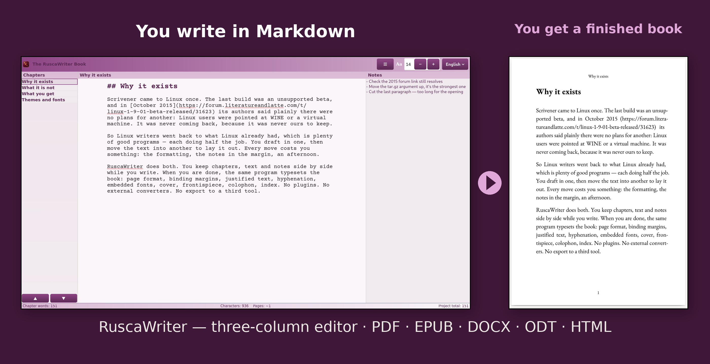

> **This repository is archived.** RuscaWriter is now part of RuscaLinux.
>
> - Website: https://www.ruscalinux.org
> - Source code: https://github.com/ruscalinux/ruscalinux
> - Downloads: https://sourceforge.net/projects/ruscalinux/

# RuscaWriter

**Writing and typesetting in one small program.**

Write the book, then print the book.



Part of the [RuscaLinux](https://www.ruscalinux.org/) project. Free software,
GNU GPL v3 or later.

## Why it exists

Scrivener came to Linux once. The last build was an unsupported beta, and in
[October 2015](https://forum.literatureandlatte.com/t/linux-1-9-01-beta-released/31623)
its authors said plainly there were no plans for another: Linux users were
pointed at WINE or a virtual machine. It was never coming back, because it was
never ours to keep.

So Linux writers went back to what Linux already had, which is plenty of good
programs — each doing half the job. You draft in one, then move the text into
another to lay it out. Every move costs you something: the formatting, the
notes in the margin, an afternoon.

RuscaWriter does both. You keep chapters, text and notes side by side while you
write. When you are done, the same program typesets the book: page format,
binding margins, justified text, hyphenation, embedded fonts, cover,
frontispiece, colophon, index. No plugins. No external converters. No export to
a third tool.

## Why it has to be free software

The 2015 story is not a grievance, it is the argument. Those users had done
nothing wrong. They had bought nothing that expired, broken no rule, made no
mistake. The program left because it belonged to someone else, and that someone
had every right to stop.

A book is written over years. It outlives programs, operating systems and
companies, and the file it lives in has to outlive them too. A manuscript held
in a format only one program can open is a manuscript held hostage to that
program's business decisions — and to whether Linux is still worth the trouble
next quarter.

So the guarantees here are not promises, they are properties you can check:

- **The source is yours.** GPL v3. If this project stops, anyone can continue
  it. Nobody has to ask.
- **The format is plain text.** A `.rwr` file is a `tar.gz` of Markdown files.
  Even with every copy of RuscaWriter gone from the earth, `tar xzf` gets your
  chapters back, readable in any editor.
- **It never connects to the network.** No account, no licence check, no
  subscription that lapses, nothing to phone home about your work.
- **It exports to formats other programs read.** PDF, EPUB, DOCX, ODT, HTML,
  Markdown, plain text. Leaving is always possible, which is the only reason
  staying means anything.

Free software is not a moral flourish on the end of a feature list. For a tool
you trust a book to, it is the feature.

## What it is not

RuscaWriter is not a Scrivener clone, and does not try to become one. It takes
one idea from it — chapters, text and notes side by side, and a single program
that both drafts and typesets — and stops there.

The chapter column is the outline, and it is a flat one: titles you can rename
and reorder, with the whole book previewable in one view. That is as far as the
structure goes. There are no nested documents, no synopsis cards, no metadata
columns.

There is no corkboard, no snapshots, no research folder, no split editor, no
compile presets, no collections, no labels and status. Those are good features
in the program that has them. Their absence here is not a gap waiting to be
filled: it is what keeps this one small enough to open, learn in an afternoon,
and then forget about while you write.

The interface is deliberately plain. The typesetting is not.

## What you get

- **Three columns.** Chapter list, your text, notes for that chapter. All at
  once.
- **Markdown.** Plain text. Headings, bold, italic, quotes, lists, links,
  images.
- **Real typesetting.** Five book page sizes. Binding margins that keep text
  out of the spine. Justified lines. Hyphenation. EB Garamond embedded in the
  PDF.
- **A cover.** Attach your own image, or generate a typographic one and watch
  the preview change as you type.
- **Editorial sections.** Cover, frontispiece, colophon. Filled in as fields,
  laid out for you.
- **Export.** PDF, EPUB, DOCX, ODT, HTML, Markdown, TXT, and AZW3 for Kindle
  if Calibre is installed.
- **Spell checking** that understands Italian and French elisions
  (*dell'anima*, *l'uomo*).
- **40 interface languages**, switched on the fly. Two themes — the plum of
  RuscaLinux and a classic Standard one — each in a light and a dark version.
- **Your files stay yours.** A `.rwr` project is a tar.gz of Markdown files.
  Open it with anything, forever.

## Built to be safe

RuscaWriter is written in **Python 3 and GTK 4**. Nothing else is required to
run it.

- **It never goes online.** No network code, no telemetry, no accounts, no
  update checks. It works with the machine unplugged.
- **PDF, EPUB, ODT and DOCX are written using only the Python standard
  library.** No third-party document engine, so no dependency chain to trust.
- **Images are checked by content, not by file name.** A file claiming to be a
  PNG is read as a PNG only if its bytes say so.
- **Optional parts stay optional.** If Pillow or Pyphen is missing, the related
  button is greyed out and everything else keeps working.
- **Automated tests** cover the data model and every export path.

See [SECURITY.md](SECURITY.md) for the full picture and how to report a
problem.

## Install and run

Debian, Ubuntu, RuscaLinux:

```
sudo apt install python3-gi gir1.2-gtk-4.0
python3 ruscawriter.py
```

Or take the `.deb` from the
[Releases](https://github.com/ruscalinux-dev/ruscawriter/releases) page.

### Optional extras

Each one adds a feature. Skip any of them and the program still runs.

| Install                                                 | Adds                                  |
| ------------------------------------------------------- | ------------------------------------- |
| `gir1.2-spelling-1 gir1.2-gtksource-5 hunspell-en-us`    | spell checking                        |
| `python3-pil`                                            | cover generator, WebP in PDF and DOCX |
| `python3-pyphen hyphen-en-us`                            | hyphenation in the PDF                |
| `calibre`                                                | AZW3 export for Kindle                |

Add more `hunspell-<lang>` and `hyphen-<lang>` for the languages you write in.
Spell checking needs **libspelling** (the one GNOME Text Editor uses); Gspell
and GtkSpell are GTK 3 and will not work.

## Keyboard shortcuts

Useful in full screen, where GTK menus can be awkward with some window
managers.

- `Ctrl+N` new · `Ctrl+O` open · `Ctrl+S` save · `Ctrl+I` import as chapters
- `Ctrl+Shift+N` add chapter · `F2` rename chapter
- `Ctrl+F` find and replace · `Ctrl+Shift+I` insert image
- `Ctrl++` / `Ctrl+-` text size
- `Ctrl+E` preview · `Ctrl+Shift+E` preview whole document
- `Ctrl+L` / `Ctrl+R` show or hide a column · `F11` full screen
- `Ctrl+Shift+D` light or dark (the theme itself is under View → Theme)
- `F1` About · `Shift+F1` Markdown guide

## Languages

40 interface languages, switched from **View → Language**. Seven are complete:
English, Italian, Spanish, French, German, Portuguese, Russian. The rest fall
back to English and are marked as such in the menu.

To translate one, copy `lang/en.json`, translate the values, leave the keys
alone. Nothing else in the code needs to change.

## Markdown

Headings, bold, italic, code, quotes, lists, links and images — the set shown
in the guide under Help (`Shift+F1`).

Links are written `[label](address)`. The address is printed in full next to
the label and is never clickable: a book gets printed, and on paper an
address nobody can see is a source nobody can reach.

The rules live in one place, `classify_md_line()` and `parse_inline()` in
`src/ruscawriter/model.py`. Every reader goes through them: the PDF typesetter,
the HTML and EPUB exports, the ODT and DOCX exports, the preview, and the live
highlighting in the editor. That is what makes the preview trustworthy — what
you see highlighted while typing is what the exports will produce.

## Fonts

RuscaWriter ships two: a typewriter face and a reading serif. Under
View → Fonts you choose **two fonts separately** — the one you write and read
in on screen, and the one the exported PDF is set in. They are different jobs:
you spend hours on a draft, while the PDF is the book.

Either built-in font can be used for either job, and so can any TrueType family
installed on your machine. The export font is embedded in the PDF, so the file
reads the same on any computer.

Only TrueType (`.ttf`) families are listed. The PDF writer embeds glyph
outlines in that format, so an OpenType/CFF face could be shown on screen but
not put inside the PDF, and offering it would promise more than it can keep.

## PDF

Beside the printed table of contents, the exported PDF carries a real outline:
the chapter tree readers show in their sidebar, so a long manuscript can be
navigated without scrolling. The reader is asked to open that panel by default.

## Themes

Two colour families, picked from **View → Theme**:

Five themes, named after five gems. The names are translated, and each
carries a dot in its own colour:

- **Ametista** — the plum of RuscaLinux. The bars keep the full colour, because
  that is the distribution's face; the page does not.
- **Rubino** — deep red on paper with a rose veil.
- **Zaffiro** — blue, deliberately low in saturation. Blue is the colour the eye
  focuses worst, so here the accent stays on the selection alone.
- **Giada** — sage green, the most restful of the five.
- **Ambra** — honey and brass, the warmest.

The gem changes, the discipline does not: no pure white, no pure black, and body
text between 12:1 and 14:1 — not the 21:1 the extremes give you. Full white
glares; white on black makes the letters bloom. Each theme carries its own
paper, ink and night ground, tinted with its stone.

Light or dark is a separate choice (`Ctrl+Shift+D`), so the two combine. Both are remembered between sessions.

### Making your own

Themes also live in a folder — `~/.config/ruscawriter/themes/` — one small text
file each. A theme is a name and seven colours — and, if you want, the paper and the bars
as well:

```
nome = Standard verde
accento        = #2E7D4F
accento-scuro  = #1B5233
accento-chiaro = #C7E3D3
accento-acceso = #8FD3AC
codice         = #2A6B48
velo-chiaro    = #E4F2E9
velo-scuro     = #23372C
```

Save it with a `.theme` extension and it appears under View → Theme on the next
start, in both a light and a dark version — those are built from your seven
colours, not written by hand. The keys work in Italian or English. The folder
comes with a commented example to copy, and a file with a mistake in it is
reported on startup rather than silently ignored.

Colours live in one place, `theme_palette()` in `src/ruscawriter/model.py`. It
returns roles — accent, editor background, headings — not colour names, and the
stylesheet is generated from them. A third family is a new branch in that
function and a name in `THEMES`; nothing else changes.

## How it was made

I designed RuscaWriter: the idea, the three-column layout, the visual design,
the plum theme, the feature set, the typesetting decisions, the export
pipeline. The Python code was written with the help of AI tools, from my
step-by-step direction, and reviewed and tested at every stage.

I say so openly because it is the honest description of how this was built: a
person deciding what to make and how it should work, and AI used as a tool to
write the code.

— Nunzio Curcuruto

## Contributing

Bug reports, translations, fixes and features are welcome. See
[CONTRIBUTING.md](CONTRIBUTING.md). Run the tests with
`python3 tests/test_ruscawriter.py`.

## Licence

Copyright © 2026 Nunzio Curcuruto. Free software under the **GNU General Public
License v3 or later** — full text in [LICENSE](LICENSE).

The bundled fonts, EB Garamond and Courier Prime, are under the **SIL Open Font
License 1.1**; their texts are in `assets/`.

- Website: <https://www.ruscalinux.org/ruscawriter/>
- Support the project: <https://ko-fi.com/ruscalinuxdev>
